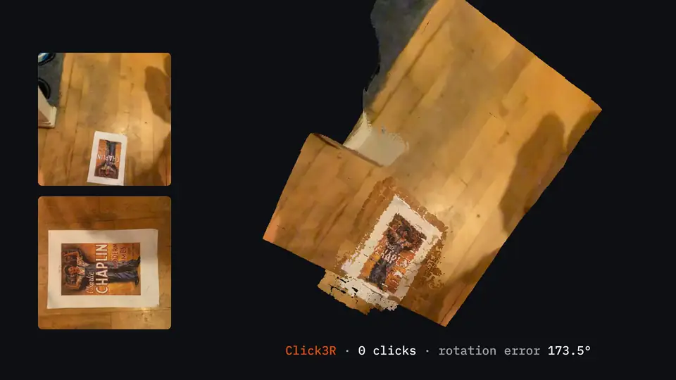

<div align="center">

# Click3R: Interactive Stereo 3D Reconstruction with Sparse Correspondence Clicks

**NeurIPS 2026**

[](https://uva-computer-vision-lab.github.io/click3r)
[](https://huggingface.co/spaces/uva-cv-lab/Click3R)
[](https://huggingface.co/uva-cv-lab/Click3R)
[](https://huggingface.co/datasets/uva-cv-lab/Hard3DBench)
[](https://arxiv.org/abs/2611.12875)

</div>



Official implementation of **Click3R**. Feed-forward 3D reconstruction models give you one prediction, and when it goes wrong there is no way to fix it. With Click3R you click a few matching points in the two images, and the model uses them to correct the reconstruction, with as few as one click.

## Updates

- **[Nov 2026]** Training and evaluation code, weights, Hard3DBench and the online demo are released.

## Getting Started

### Installation

The quickest way is to run `python demo.py` from the repository root (Python 3.11, Git and an NVIDIA GPU). On its first run it creates a local `.venv`, installs everything and downloads the weights, which takes a few minutes.

If you prefer to manage the environment yourself:

1. Clone Click3R.
```bash
git clone https://github.com/UVA-Computer-Vision-Lab/click3r
cd click3r
```

2. Create the environment.
```bash
conda create -n click3r python=3.11
conda activate click3r
pip install torch==2.5.1 torchvision==0.20.1  # choose the build for your CUDA
pip install -r requirements.txt
git clone https://github.com/facebookresearch/segment-anything third_party/segment-anything
git -C third_party/segment-anything checkout dca509fe793f601edb92606367a655c15ac00fdf
```

3. Optional, compile the cuda kernels for RoPE (as in CroCo v2). Pi3X needs them, and our Hard3DBench runs used them.
```bash
cd third_party/dust3r/croco/models/curope
python setup.py build_ext --inplace
cd ../../../../..
```

### Checkpoints

| Model | Resolution | Encoder | Decoder | Params | Download |
|-------|------------|---------|---------|--------|----------|
| Click3R | 224×224 | ViT-L | ViT-B | 566.6M | [Hugging Face](https://huggingface.co/uva-cv-lab/Click3R) |
| DUSt3R (retrained) | 224×224 | ViT-L | ViT-B | 532.3M | [Hugging Face](https://huggingface.co/uva-cv-lab/Click3R-DUSt3R-retrained) |

The demo downloads Click3R for you. To get them by hand:
```bash
hf download uva-cv-lab/Click3R click3r.pth --local-dir checkpoints
hf download uva-cv-lab/Click3R-DUSt3R-retrained retrained.pth --local-dir checkpoints/dust3r
```

### Interactive Demo

Try the [online demo](https://huggingface.co/spaces/uva-cv-lab/Click3R), or run it on your own GPU and open the link it prints:
```bash
python demo.py  # add --skip-setup if you installed with conda
```

Choose an example or upload two images of the same scene. For an example, **Add suggested clicks** fills in its clicks; for your own images, click a point in Image 1 and then the same point in Image 2. Press **Reconstruct** to compare the 3D results of DUSt3R and Click3R. The demo shows and uses the central square of each image.

In **Display settings**, **Point size (px)** adjusts both 3D views immediately (default: 3). Enable **Show information panels** to see correspondence details and reconstruction messages.

Use `--share` to get a public link, or `--server-name 0.0.0.0` and `--server-port` to serve it yourself.

## Hard3DBench

Hard3DBench is the benchmark we curated to expose where feed-forward models fail. We provide the sample lists, failure categories and human clicks on [Hugging Face](https://huggingface.co/datasets/uva-cv-lab/Hard3DBench), and the preprocessing scripts to prepare the data yourself ([docs/datasets.md](docs/datasets.md#hard3dbench)).

| Split | Source datasets | 2-view pairs | 5-view tuples |
|-------|-----------------|--------------|---------------|
| In-Distribution | BlendedMVS, CO3D, Habitat, WildRGB-D | 404 | 400 |
| Out-of-Distribution | 7Scenes, DTU, ETH3D, NRGBD, ScanNet | 300 | 300 |

## Evaluation

To reproduce the Hard3DBench table for Click3R (2-view):
```bash
# In-Distribution
python evaluation/hard3dbench/two_view.py --split indist --model click3r \
  --checkpoint checkpoints/click3r.pth --num-prompts 0 1 4 8 \
  --data-root /path/to/processed_data --co3d-root /path/to/table1_data \
  --results-dir outputs/table2

# Out-of-Distribution
python evaluation/hard3dbench/two_view.py --split ood --model click3r \
  --checkpoint checkpoints/click3r.pth --num-prompts 0 1 4 8 \
  --ood-root /path/to/hard3dbench_ood --results-dir outputs/table2
```
Use `five_view.py` for the 5-view rows, and `--model` for the baselines.

For the standard benchmarks (CO3D, ScanNet++, ARKitScenes):
```bash
python scripts/download_checkpoints.py --dust3r-retrained-source
python evaluation/reproduce_table1.py --data-root /path/to/table1_data --output-dir outputs/table1
python evaluation/summarize_table1.py outputs/table1 --output outputs/table1_summary
```

See [docs/eval.md](docs/eval.md) for the baselines and the evaluation protocol, and [docs/datasets.md](docs/datasets.md) for data preparation.

## Training

We train on nine datasets: BlendedMVS, MegaDepth, CO3D, StaticThings3D, Waymo, ARKitScenes, WildRGB-D, Habitat and ScanNet++. Please download them from their official sources and convert them following [docs/datasets.md](docs/datasets.md).

```bash
python train.py --data-root /path/to/processed_data
```

This trains for 100 epochs on 4 GPUs with 16 pairs per GPU, about 234 hours on A100s. Run the same command again to resume, and add `--skip-setup` if you installed with conda. See [docs/train.md](docs/train.md) for the hyperparameters.

## Acknowledgements

We acknowledge the following awesome open source work: [DUSt3R](https://github.com/naver/dust3r), [CroCo](https://github.com/naver/croco), [Segment Anything](https://github.com/facebookresearch/segment-anything), [MASt3R](https://github.com/naver/mast3r), [VGGT](https://github.com/facebookresearch/vggt) and [Pi3](https://github.com/yyfz/Pi3).

## Citation

```bibtex
@inproceedings{gu2026click3r,
  title={Click3R: Interactive Stereo 3D Reconstruction with Sparse Correspondence Clicks},
  author={Gu, Hao and Yao, Jin and Cheng, Zezhou},
  booktitle={Advances in Neural Information Processing Systems},
  year={2026}
}
```

## License

The code is released under the [MIT License](LICENSE), except for files adapted from other projects, which state their license in the file header. The checkpoints are released under CC BY-NC-SA 4.0, as they are initialized from CroCo v2 and trained on non-commercial datasets. See [docs/third_party.md](docs/third_party.md) for third-party notices.
